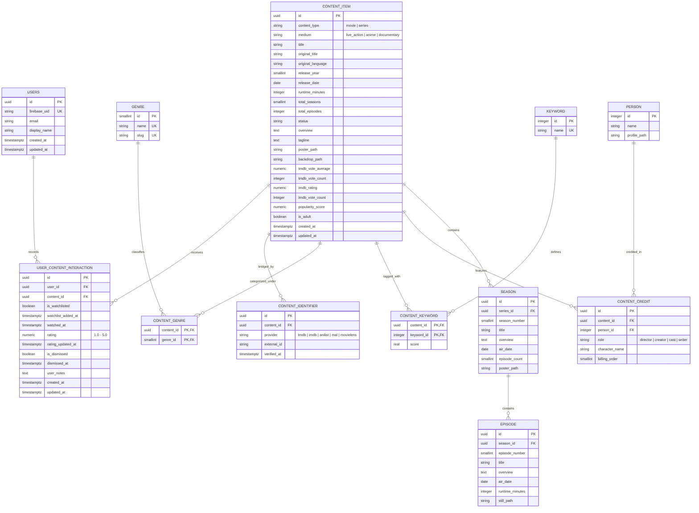
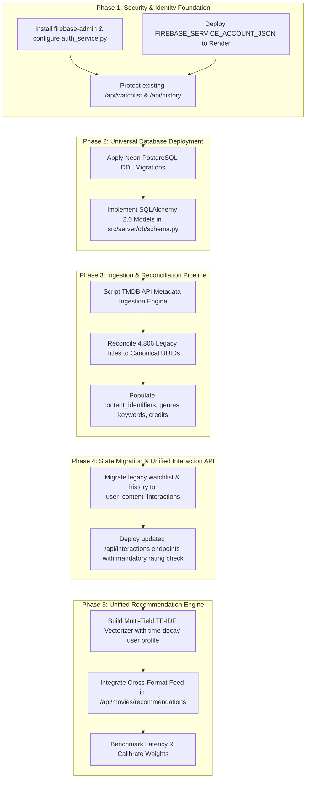

# CINECUE — Phase 0.1: Architecture Validation & Database Design Specification

**Role**: Senior Backend Architect, Database Engineer & Machine Learning Systems Architect  
**Status**: Architecture & Systems Design Specification (Validated)  
**Target Platform**: CINECUE (Single-User Personal Entertainment Discovery & Recommendation Platform)  
**Date**: November 2026  

---

## 1. Final Architecture Overview

CINECUE is evolving from an isolated ~4,800-title movie recommender into a **Universal Entertainment Discovery and Recommendation Platform** designed specifically for personal, single-user ownership.

### Core Architectural Pillars

```
┌─────────────────────────────────────────────────────────────────────────────┐
│                             CINECUE PLATFORM                                │
├─────────────────────────────────────────────────────────────────────────────┤
│  1. ONE UNIVERSAL CATALOGUE                                                 │
│     Movies · TV Series · Anime Movies · Anime Series · Documentaries        │
│     (Anime is classified as medium/category; films are movies, shows are series)│
├─────────────────────────────────────────────────────────────────────────────┤
│  2. ONE UNIFIED TASTE PROFILE                                               │
│     Single dynamic user vector across genres, themes, keywords, directors   │
│     Unified representation across live-action and animated media            │
├─────────────────────────────────────────────────────────────────────────────┤
│  3. ONE UNIFIED HYBRID RECOMMENDATION ENGINE                                │
│     Multi-field Content TF-IDF + Dynamic Interaction Vector (Ratings/Intent) │
│     Ranked hybrid scoring producing a single cross-medium feed              │
└─────────────────────────────────────────────────────────────────────────────┘
```

### Viewing Experience Paradigm
1. **Manual Viewing Tracking**: CINECUE is an index and discovery platform, not a media streaming host. Playback duration and percentage tracking are explicitly omitted.
2. **Atomic Watched Status & Mandatory Rating**: When the user marks a title as watched, the system enforces a rating ($1.0$ to $5.0$ stars). A record cannot be marked watched without an explicit rating. Ratings may be updated at any time.
3. **Decoupled Watchlist Intent**: Watchlisting is an aspirational intent signal (weaker positive weight). Removing a title from the watchlist never deletes historical ratings or watched history.
4. **Explicit Dismissal Signals**: "Not interested" or "Dismiss" actions are isolated negative filters, distinct from low star ratings.
5. **Series-Level Granularity**: Initial implementation tracks interactions at the series level. Season and episode hierarchies are modeled in the schema for discovery metadata but decoupled from user tracking.

---

## 2. Complete Entity-Relationship (ER) Diagram



---

## 3. Database Schema Specification (PostgreSQL DDL)

The universal schema operates on Neon PostgreSQL. It uses standard extensions, domain constraints, check constraints, and partial indexes for high read performance.

```sql
-- 1. Enable Core Extensions
CREATE EXTENSION IF NOT EXISTS "uuid-ossp";
CREATE EXTENSION IF NOT EXISTS "pg_trgm";

-- 2. Enumerated Domain Types
CREATE TYPE content_type_enum AS ENUM ('movie', 'series');
CREATE TYPE medium_enum AS ENUM ('live_action', 'anime', 'documentary');
CREATE TYPE credit_role_enum AS ENUM ('director', 'creator', 'cast', 'writer');
CREATE TYPE provider_enum AS ENUM ('tmdb', 'imdb', 'anilist', 'mal', 'movielens');

-- 3. Users Table (Synchronized with Firebase Auth UID)
CREATE TABLE users (
    id UUID PRIMARY KEY DEFAULT uuid_generate_v4(),
    firebase_uid VARCHAR(128) NOT NULL UNIQUE,
    email VARCHAR(255) NULL,
    display_name VARCHAR(100) NULL,
    created_at TIMESTAMPTZ NOT NULL DEFAULT NOW(),
    updated_at TIMESTAMPTZ NOT NULL DEFAULT NOW()
);
CREATE INDEX idx_users_firebase_uid ON users(firebase_uid);

-- 4. Canonical Content Items (Universal Catalogue)
CREATE TABLE content_items (
    id UUID PRIMARY KEY DEFAULT uuid_generate_v4(),
    content_type content_type_enum NOT NULL,
    medium medium_enum NOT NULL DEFAULT 'live_action',
    title VARCHAR(500) NOT NULL,
    original_title VARCHAR(500) NULL,
    original_language VARCHAR(10) NULL DEFAULT 'en',
    release_year SMALLINT CHECK (release_year BETWEEN 1880 AND 2100),
    release_date DATE NULL,
    runtime_minutes INTEGER CHECK (runtime_minutes > 0),
    total_seasons SMALLINT CHECK (total_seasons >= 0),
    total_episodes INTEGER CHECK (total_episodes >= 0),
    status VARCHAR(50) DEFAULT 'Released',
    overview TEXT NULL,
    tagline TEXT NULL,
    poster_path VARCHAR(255) NULL,
    backdrop_path VARCHAR(255) NULL,
    tmdb_vote_average NUMERIC(3, 1) CHECK (tmdb_vote_average BETWEEN 0.0 AND 10.0),
    tmdb_vote_count INTEGER DEFAULT 0 CHECK (tmdb_vote_count >= 0),
    imdb_rating NUMERIC(3, 1) CHECK (imdb_rating BETWEEN 0.0 AND 10.0),
    imdb_vote_count INTEGER DEFAULT 0 CHECK (imdb_vote_count >= 0),
    popularity_score NUMERIC(8, 3) DEFAULT 0.0,
    is_adult BOOLEAN NOT NULL DEFAULT FALSE,
    created_at TIMESTAMPTZ NOT NULL DEFAULT NOW(),
    updated_at TIMESTAMPTZ NOT NULL DEFAULT NOW()
);

-- Search and Filter Indexes
CREATE INDEX idx_content_type_medium ON content_items(content_type, medium);
CREATE INDEX idx_content_release_year ON content_items(release_year DESC);
CREATE INDEX idx_content_popularity ON content_items(popularity_score DESC);
CREATE INDEX idx_content_title_trgm ON content_items USING gin (title gin_trgm_ops);

-- 5. External Provider Identity Bridge
CREATE TABLE content_identifiers (
    id UUID PRIMARY KEY DEFAULT uuid_generate_v4(),
    content_id UUID NOT NULL REFERENCES content_items(id) ON DELETE CASCADE,
    provider provider_enum NOT NULL,
    external_id VARCHAR(64) NOT NULL,
    verified_at TIMESTAMPTZ DEFAULT NOW(),
    CONSTRAINT uq_provider_external_id UNIQUE (provider, external_id)
);
CREATE INDEX idx_identifiers_lookup ON content_identifiers(provider, external_id);
CREATE INDEX idx_identifiers_content_id ON content_identifiers(content_id);

-- 6. User Content Interaction (Consolidated Taste Profile Repository)
CREATE TABLE user_content_interactions (
    id UUID PRIMARY KEY DEFAULT uuid_generate_v4(),
    user_id UUID NOT NULL REFERENCES users(id) ON DELETE CASCADE,
    content_id UUID NOT NULL REFERENCES content_items(id) ON DELETE CASCADE,
    is_watchlisted BOOLEAN NOT NULL DEFAULT FALSE,
    watchlist_added_at TIMESTAMPTZ NULL,
    watched_at TIMESTAMPTZ NULL,
    rating NUMERIC(2, 1) NULL CHECK (rating IS NULL OR (rating >= 1.0 AND rating <= 5.0)),
    rating_updated_at TIMESTAMPTZ NULL,
    is_dismissed BOOLEAN NOT NULL DEFAULT FALSE,
    dismissed_at TIMESTAMPTZ NULL,
    user_notes TEXT NULL,
    created_at TIMESTAMPTZ NOT NULL DEFAULT NOW(),
    updated_at TIMESTAMPTZ NOT NULL DEFAULT NOW(),
    
    -- Invariants: Exactly one record per user/content pair
    CONSTRAINT uq_user_content_interaction UNIQUE (user_id, content_id),
    
    -- Mandatory rating condition: If marked watched, rating is non-null
    CONSTRAINT chk_watched_requires_rating CHECK (
        (watched_at IS NULL) OR (watched_at IS NOT NULL AND rating IS NOT NULL)
    ),
    
    -- Watchlist timestamp integrity
    CONSTRAINT chk_watchlist_consistency CHECK (
        (is_watchlisted = FALSE AND watchlist_added_at IS NULL) OR 
        (is_watchlisted = TRUE AND watchlist_added_at IS NOT NULL)
    ),

    -- Dismissal timestamp integrity
    CONSTRAINT chk_dismissed_consistency CHECK (
        (is_dismissed = FALSE AND dismissed_at IS NULL) OR 
        (is_dismissed = TRUE AND dismissed_at IS NOT NULL)
    )
);

-- Interaction Query Indexes
CREATE INDEX idx_interactions_user_watched ON user_content_interactions(user_id, watched_at DESC) 
    WHERE watched_at IS NOT NULL;
CREATE INDEX idx_interactions_user_watchlist ON user_content_interactions(user_id, watchlist_added_at DESC) 
    WHERE is_watchlisted = TRUE;
CREATE INDEX idx_interactions_user_dismissed ON user_content_interactions(user_id) 
    WHERE is_dismissed = TRUE;

-- 7. Taxonomy: Genres
CREATE TABLE genres (
    id SMALLSERIAL PRIMARY KEY,
    name VARCHAR(50) NOT NULL UNIQUE,
    slug VARCHAR(50) NOT NULL UNIQUE
);

CREATE TABLE content_genres (
    content_id UUID NOT NULL REFERENCES content_items(id) ON DELETE CASCADE,
    genre_id SMALLINT NOT NULL REFERENCES genres(id) ON DELETE RESTRICT,
    PRIMARY KEY (content_id, genre_id)
);
CREATE INDEX idx_content_genres_genre ON content_genres(genre_id);

-- 8. Taxonomy: Keywords & Sub-themes
CREATE TABLE keywords (
    id SERIAL PRIMARY KEY,
    name VARCHAR(100) NOT NULL UNIQUE
);

CREATE TABLE content_keywords (
    content_id UUID NOT NULL REFERENCES content_items(id) ON DELETE CASCADE,
    keyword_id INTEGER NOT NULL REFERENCES keywords(id) ON DELETE RESTRICT,
    score REAL DEFAULT 1.0,
    PRIMARY KEY (content_id, keyword_id)
);
CREATE INDEX idx_content_keywords_keyword ON content_keywords(keyword_id);

-- 9. People & Credits (Cast, Directors, Writers, Creators)
CREATE TABLE persons (
    id SERIAL PRIMARY KEY,
    name VARCHAR(255) NOT NULL,
    profile_path VARCHAR(255) NULL
);
CREATE INDEX idx_persons_name_trgm ON persons USING gin (name gin_trgm_ops);

CREATE TABLE content_credits (
    id UUID PRIMARY KEY DEFAULT uuid_generate_v4(),
    content_id UUID NOT NULL REFERENCES content_items(id) ON DELETE CASCADE,
    person_id INTEGER NOT NULL REFERENCES persons(id) ON DELETE RESTRICT,
    role credit_role_enum NOT NULL,
    character_name VARCHAR(255) NULL,
    billing_order SMALLINT DEFAULT 0,
    CONSTRAINT uq_content_person_role UNIQUE (content_id, person_id, role, character_name)
);
CREATE INDEX idx_content_credits_content ON content_credits(content_id);
CREATE INDEX idx_content_credits_person ON content_credits(person_id);

-- 10. Series Structure: Seasons & Episodes (Metadata Hierarchy)
CREATE TABLE seasons (
    id UUID PRIMARY KEY DEFAULT uuid_generate_v4(),
    series_id UUID NOT NULL REFERENCES content_items(id) ON DELETE CASCADE,
    season_number SMALLINT NOT NULL,
    title VARCHAR(255) NULL,
    overview TEXT NULL,
    air_date DATE NULL,
    episode_count SMALLINT DEFAULT 0,
    poster_path VARCHAR(255) NULL,
    CONSTRAINT uq_series_season_number UNIQUE (series_id, season_number)
);

CREATE TABLE episodes (
    id UUID PRIMARY KEY DEFAULT uuid_generate_v4(),
    season_id UUID NOT NULL REFERENCES seasons(id) ON DELETE CASCADE,
    episode_number SMALLINT NOT NULL,
    title VARCHAR(255) NOT NULL,
    overview TEXT NULL,
    air_date DATE NULL,
    runtime_minutes INTEGER NULL,
    still_path VARCHAR(255) NULL,
    CONSTRAINT uq_season_episode_number UNIQUE (season_id, episode_number)
);
```

---

## 4. SQLAlchemy 2.0 Model Declarations

```python
# src/server/db/schema.py
from __future__ import annotations
import enum
from datetime import datetime, date
from decimal import Decimal
from typing import List, Optional
import uuid

from sqlalchemy import (
    String, Text, Integer, SmallInteger, Numeric, Boolean, Date, DateTime,
    ForeignKey, UniqueConstraint, CheckConstraint, Index
)
from sqlalchemy.dialects.postgresql import UUID
from sqlalchemy.orm import DeclarativeBase, Mapped, mapped_column, relationship

class Base(DeclarativeBase):
    pass

class ContentTypeEnum(str, enum.Enum):
    movie = "movie"
    series = "series"

class MediumEnum(str, enum.Enum):
    live_action = "live_action"
    anime = "anime"
    documentary = "documentary"

class CreditRoleEnum(str, enum.Enum):
    director = "director"
    creator = "creator"
    cast = "cast"
    writer = "writer"

class ProviderEnum(str, enum.Enum):
    tmdb = "tmdb"
    imdb = "imdb"
    anilist = "anilist"
    mal = "mal"
    movielens = "movielens"

class User(Base):
    __tablename__ = "users"

    id: Mapped[uuid.UUID] = mapped_column(UUID(as_uuid=True), primary_key=True, default=uuid.uuid4)
    firebase_uid: Mapped[str] = mapped_column(String(128), unique=True, nullable=False, index=True)
    email: Mapped[Optional[str]] = mapped_column(String(255), nullable=True)
    display_name: Mapped[Optional[str]] = mapped_column(String(100), nullable=True)
    created_at: Mapped[datetime] = mapped_column(DateTime(timezone=True), default=datetime.utcnow)
    updated_at: Mapped[datetime] = mapped_column(DateTime(timezone=True), default=datetime.utcnow, onupdate=datetime.utcnow)

    interactions: Mapped[List[UserContentInteraction]] = relationship(back_populates="user", cascade="all, delete-orphan")

class ContentItem(Base):
    __tablename__ = "content_items"

    id: Mapped[uuid.UUID] = mapped_column(UUID(as_uuid=True), primary_key=True, default=uuid.uuid4)
    content_type: Mapped[ContentTypeEnum] = mapped_column(String(20), nullable=False)
    medium: Mapped[MediumEnum] = mapped_column(String(20), nullable=False, default=MediumEnum.live_action)
    title: Mapped[str] = mapped_column(String(500), nullable=False)
    original_title: Mapped[Optional[str]] = mapped_column(String(500), nullable=True)
    original_language: Mapped[str] = mapped_column(String(10), default="en")
    release_year: Mapped[Optional[int]] = mapped_column(SmallInteger, nullable=True)
    release_date: Mapped[Optional[date]] = mapped_column(Date, nullable=True)
    runtime_minutes: Mapped[Optional[int]] = mapped_column(Integer, nullable=True)
    total_seasons: Mapped[Optional[int]] = mapped_column(SmallInteger, nullable=True)
    total_episodes: Mapped[Optional[int]] = mapped_column(Integer, nullable=True)
    status: Mapped[str] = mapped_column(String(50), default="Released")
    overview: Mapped[Optional[str]] = mapped_column(Text, nullable=True)
    tagline: Mapped[Optional[str]] = mapped_column(Text, nullable=True)
    poster_path: Mapped[Optional[str]] = mapped_column(String(255), nullable=True)
    backdrop_path: Mapped[Optional[str]] = mapped_column(String(255), nullable=True)
    tmdb_vote_average: Mapped[Optional[Decimal]] = mapped_column(Numeric(3, 1), nullable=True)
    tmdb_vote_count: Mapped[int] = mapped_column(Integer, default=0)
    imdb_rating: Mapped[Optional[Decimal]] = mapped_column(Numeric(3, 1), nullable=True)
    imdb_vote_count: Mapped[int] = mapped_column(Integer, default=0)
    popularity_score: Mapped[Decimal] = mapped_column(Numeric(8, 3), default=Decimal("0.0"))
    is_adult: Mapped[bool] = mapped_column(Boolean, default=False)
    created_at: Mapped[datetime] = mapped_column(DateTime(timezone=True), default=datetime.utcnow)
    updated_at: Mapped[datetime] = mapped_column(DateTime(timezone=True), default=datetime.utcnow, onupdate=datetime.utcnow)

    identifiers: Mapped[List[ContentIdentifier]] = relationship(back_populates="content", cascade="all, delete-orphan")
    interactions: Mapped[List[UserContentInteraction]] = relationship(back_populates="content", cascade="all, delete-orphan")
    genres: Mapped[List[Genre]] = relationship(secondary="content_genres", back_populates="content_items")
    keywords: Mapped[List[Keyword]] = relationship(secondary="content_keywords", back_populates="content_items")
    credits: Mapped[List[ContentCredit]] = relationship(back_populates="content", cascade="all, delete-orphan")
    seasons: Mapped[List[Season]] = relationship(back_populates="series", cascade="all, delete-orphan")

class ContentIdentifier(Base):
    __tablename__ = "content_identifiers"
    __table_args__ = (
        UniqueConstraint("provider", "external_id", name="uq_provider_external_id"),
        Index("idx_identifiers_lookup", "provider", "external_id"),
    )

    id: Mapped[uuid.UUID] = mapped_column(UUID(as_uuid=True), primary_key=True, default=uuid.uuid4)
    content_id: Mapped[uuid.UUID] = mapped_column(UUID(as_uuid=True), ForeignKey("content_items.id", ondelete="CASCADE"), nullable=False)
    provider: Mapped[ProviderEnum] = mapped_column(String(20), nullable=False)
    external_id: Mapped[str] = mapped_column(String(64), nullable=False)
    verified_at: Mapped[datetime] = mapped_column(DateTime(timezone=True), default=datetime.utcnow)

    content: Mapped[ContentItem] = relationship(back_populates="identifiers")

class UserContentInteraction(Base):
    __tablename__ = "user_content_interactions"
    __table_args__ = (
        UniqueConstraint("user_id", "content_id", name="uq_user_content_interaction"),
        CheckConstraint("rating IS NULL OR (rating >= 1.0 AND rating <= 5.0)", name="chk_valid_rating_range"),
        CheckConstraint("(watched_at IS NULL) OR (watched_at IS NOT NULL AND rating IS NOT NULL)", name="chk_watched_requires_rating"),
        CheckConstraint("(is_watchlisted = FALSE AND watchlist_added_at IS NULL) OR (is_watchlisted = TRUE AND watchlist_added_at IS NOT NULL)", name="chk_watchlist_consistency"),
        CheckConstraint("(is_dismissed = FALSE AND dismissed_at IS NULL) OR (is_dismissed = TRUE AND dismissed_at IS NOT NULL)", name="chk_dismissed_consistency"),
    )

    id: Mapped[uuid.UUID] = mapped_column(UUID(as_uuid=True), primary_key=True, default=uuid.uuid4)
    user_id: Mapped[uuid.UUID] = mapped_column(UUID(as_uuid=True), ForeignKey("users.id", ondelete="CASCADE"), nullable=False)
    content_id: Mapped[uuid.UUID] = mapped_column(UUID(as_uuid=True), ForeignKey("content_items.id", ondelete="CASCADE"), nullable=False)
    is_watchlisted: Mapped[bool] = mapped_column(Boolean, default=False, nullable=False)
    watchlist_added_at: Mapped[Optional[datetime]] = mapped_column(DateTime(timezone=True), nullable=True)
    watched_at: Mapped[Optional[datetime]] = mapped_column(DateTime(timezone=True), nullable=True)
    rating: Mapped[Optional[Decimal]] = mapped_column(Numeric(2, 1), nullable=True)
    rating_updated_at: Mapped[Optional[datetime]] = mapped_column(DateTime(timezone=True), nullable=True)
    is_dismissed: Mapped[bool] = mapped_column(Boolean, default=False, nullable=False)
    dismissed_at: Mapped[Optional[datetime]] = mapped_column(DateTime(timezone=True), nullable=True)
    user_notes: Mapped[Optional[str]] = mapped_column(Text, nullable=True)
    created_at: Mapped[datetime] = mapped_column(DateTime(timezone=True), default=datetime.utcnow)
    updated_at: Mapped[datetime] = mapped_column(DateTime(timezone=True), default=datetime.utcnow, onupdate=datetime.utcnow)

    user: Mapped[User] = relationship(back_populates="interactions")
    content: Mapped[ContentItem] = relationship(back_populates="interactions")

class Genre(Base):
    __tablename__ = "genres"

    id: Mapped[int] = mapped_column(SmallInteger, primary_key=True, autoincrement=True)
    name: Mapped[str] = mapped_column(String(50), unique=True, nullable=False)
    slug: Mapped[str] = mapped_column(String(50), unique=True, nullable=False)

    content_items: Mapped[List[ContentItem]] = relationship(secondary="content_genres", back_populates="genres")

class ContentGenre(Base):
    __tablename__ = "content_genres"

    content_id: Mapped[uuid.UUID] = mapped_column(UUID(as_uuid=True), ForeignKey("content_items.id", ondelete="CASCADE"), primary_key=True)
    genre_id: Mapped[int] = mapped_column(SmallInteger, ForeignKey("genres.id", ondelete="RESTRICT"), primary_key=True)

class Keyword(Base):
    __tablename__ = "keywords"

    id: Mapped[int] = mapped_column(Integer, primary_key=True, autoincrement=True)
    name: Mapped[str] = mapped_column(String(100), unique=True, nullable=False)

    content_items: Mapped[List[ContentItem]] = relationship(secondary="content_keywords", back_populates="keywords")

class ContentKeyword(Base):
    __tablename__ = "content_keywords"

    content_id: Mapped[uuid.UUID] = mapped_column(UUID(as_uuid=True), ForeignKey("content_items.id", ondelete="CASCADE"), primary_key=True)
    keyword_id: Mapped[int] = mapped_column(Integer, ForeignKey("keywords.id", ondelete="RESTRICT"), primary_key=True)
    score: Mapped[float] = mapped_column(default=1.0)

class Person(Base):
    __tablename__ = "persons"

    id: Mapped[int] = mapped_column(Integer, primary_key=True, autoincrement=True)
    name: Mapped[str] = mapped_column(String(255), nullable=False)
    profile_path: Mapped[Optional[str]] = mapped_column(String(255), nullable=True)

    credits: Mapped[List[ContentCredit]] = relationship(back_populates="person")

class ContentCredit(Base):
    __tablename__ = "content_credits"
    __table_args__ = (
        UniqueConstraint("content_id", "person_id", "role", "character_name", name="uq_content_person_role"),
    )

    id: Mapped[uuid.UUID] = mapped_column(UUID(as_uuid=True), primary_key=True, default=uuid.uuid4)
    content_id: Mapped[uuid.UUID] = mapped_column(UUID(as_uuid=True), ForeignKey("content_items.id", ondelete="CASCADE"), nullable=False)
    person_id: Mapped[int] = mapped_column(Integer, ForeignKey("persons.id", ondelete="RESTRICT"), nullable=False)
    role: Mapped[CreditRoleEnum] = mapped_column(String(20), nullable=False)
    character_name: Mapped[Optional[str]] = mapped_column(String(255), nullable=True)
    billing_order: Mapped[int] = mapped_column(SmallInteger, default=0)

    content: Mapped[ContentItem] = relationship(back_populates="credits")
    person: Mapped[Person] = relationship(back_populates="credits")

class Season(Base):
    __tablename__ = "seasons"
    __table_args__ = (
        UniqueConstraint("series_id", "season_number", name="uq_series_season_number"),
    )

    id: Mapped[uuid.UUID] = mapped_column(UUID(as_uuid=True), primary_key=True, default=uuid.uuid4)
    series_id: Mapped[uuid.UUID] = mapped_column(UUID(as_uuid=True), ForeignKey("content_items.id", ondelete="CASCADE"), nullable=False)
    season_number: Mapped[int] = mapped_column(SmallInteger, nullable=False)
    title: Mapped[Optional[str]] = mapped_column(String(255), nullable=True)
    overview: Mapped[Optional[str]] = mapped_column(Text, nullable=True)
    air_date: Mapped[Optional[date]] = mapped_column(Date, nullable=True)
    episode_count: Mapped[int] = mapped_column(SmallInteger, default=0)
    poster_path: Mapped[Optional[str]] = mapped_column(String(255), nullable=True)

    series: Mapped[ContentItem] = relationship(back_populates="seasons")
    episodes: Mapped[List[Episode]] = relationship(back_populates="season", cascade="all, delete-orphan")

class Episode(Base):
    __tablename__ = "episodes"
    __table_args__ = (
        UniqueConstraint("season_id", "episode_number", name="uq_season_episode_number"),
    )

    id: Mapped[uuid.UUID] = mapped_column(UUID(as_uuid=True), primary_key=True, default=uuid.uuid4)
    season_id: Mapped[uuid.UUID] = mapped_column(UUID(as_uuid=True), ForeignKey("seasons.id", ondelete="CASCADE"), nullable=False)
    episode_number: Mapped[int] = mapped_column(SmallInteger, nullable=False)
    title: Mapped[str] = mapped_column(String(255), nullable=False)
    overview: Mapped[Optional[str]] = mapped_column(Text, nullable=True)
    air_date: Mapped[Optional[date]] = mapped_column(Date, nullable=True)
    runtime_minutes: Mapped[Optional[int]] = mapped_column(Integer, nullable=True)
    still_path: Mapped[Optional[str]] = mapped_column(String(255), nullable=True)

    season: Mapped[Season] = relationship(back_populates="episodes")
```

---

## 5. Firebase Authentication & Security Architecture

### Identified Security Flaw
The Phase 0 audit confirmed that backend endpoints (`/api/watchlist`, `/api/history`, `/api/movies/recommendations`) currently accept raw query parameters such as `user_id: int` or `user_id: str`. Any unauthenticated client can read or manipulate user states simply by passing an arbitrary identifier.

### Target Architecture
1. **Cryptographic Identity Verification**: The client includes standard HTTP authorization headers:  
   `Authorization: Bearer <FIREBASE_ID_TOKEN>`
2. **Server-Side Token Verification**: The backend verifies the token using the official `firebase-admin` SDK, validating the cryptographic signature, audience, expiration, and issuer.
3. **Internal Identity Resolution**: Upon verification, the `firebase_uid` is looked up in the `users` table. If the single owner signs in for the first time on a new instance, the user record is automatically provisioned.
4. **Endpoint Injection**: The verified `User` instance is injected into routers using FastAPI's dependency injection (`Depends(get_current_user)`).

```
┌─────────────────┐       HTTP Bearer Token        ┌─────────────────────────┐
│ React Frontend  │ ─────────────────────────────> │ FastAPI Endpoint Guard  │
│ (Firebase Auth) │                                │ (auth_service.py)       │
└─────────────────┘                                └────────────┬────────────┘
                                                                │
                                            firebase_admin.auth.verify_id_token()
                                                                │
                                                                ▼
                                                   ┌─────────────────────────┐
                                                   │ Validate Signature,     │
                                                   │ Expiration & Claims     │
                                                   └────────────┬────────────┘
                                                                │
                                                    Extract `uid` from Claims
                                                                │
                                                                ▼
                                                   ┌─────────────────────────┐
                                                   │ Get or Create in Neon   │
                                                   │ SELECT * FROM users     │
                                                   │ WHERE firebase_uid = :u │
                                                   └────────────┬────────────┘
                                                                │
                                                  Injected authenticated User
                                                                ▼
                                                   ┌─────────────────────────┐
                                                   │ Business Logic Router   │
                                                   │ (/api/watchlist, etc.)  │
                                                   └─────────────────────────┘
```

### Dependency Implementation Specification

```python
# src/server/services/auth_service.py
import json
import os
from typing import Annotated
from fastapi import Depends, HTTPException, Security, status
from fastapi.security import HTTPAuthorizationCredentials, HTTPBearer
import firebase_admin
from firebase_admin import auth, credentials
from sqlalchemy.orm import Session

from src.server.db.database import get_db
from src.server.db.schema import User

# Initialize Firebase Admin once using environment credentials
if not firebase_admin._apps:
    cred_json_str = os.environ.get("FIREBASE_SERVICE_ACCOUNT_JSON")
    if cred_json_str:
        cred_dict = json.loads(cred_json_str)
        cred = credentials.Certificate(cred_dict)
        firebase_admin.initialize_app(cred)
    else:
        # Fallback for local development or Google ADC
        firebase_admin.initialize_app()

security = HTTPBearer(auto_error=True)

async def get_current_user(
    credentials_auth: Annotated[HTTPAuthorizationCredentials, Security(security)],
    db: Session = Depends(get_db)
) -> User:
    token = credentials_auth.credentials
    try:
        decoded_token = auth.verify_id_token(token, check_revoked=False)
        firebase_uid = decoded_token.get("uid")
        if not firebase_uid:
            raise HTTPException(
                status_code=status.HTTP_401_UNAUTHORIZED,
                detail="Token missing uid claim"
            )
    except Exception as exc:
        raise HTTPException(
            status_code=status.HTTP_401_UNAUTHORIZED,
            detail=f"Invalid authentication credentials: {str(exc)}",
            headers={"WWW-Authenticate": "Bearer"},
        ) from exc

    # Look up user or upsert initial owner profile
    user = db.query(User).filter(User.firebase_uid == firebase_uid).first()
    if not user:
        user = User(
            firebase_uid=firebase_uid,
            email=decoded_token.get("email"),
            display_name=decoded_token.get("name") or "CINECUE Owner"
        )
        db.add(user)
        db.commit()
        db.refresh(user)

    return user
```

### Production Deployment of Secrets on Render
- In Render Dashboard: Set Environment Variable `FIREBASE_SERVICE_ACCOUNT_JSON` containing the raw JSON service account key.
- No files are committed to Git. The backend parses this directly from memory.

---

## 6. Canonical Content Identity & ID Reconciliation

### Universal Identity Strategy
- **Internal ID**: Native UUID (`uuid4`). All foreign keys, taste profiles, vector matrix indices, and URLs reference this canonical UUID.
- **Provider Decoupling**: External IDs (`tmdb_id`, `imdb_id`, `anilist_id`) live strictly in `content_identifiers`.
- **Medium Resolution**:
  - Anime films: `content_type = 'movie'`, `medium = 'anime'`
  - Anime TV shows: `content_type = 'series'`, `medium = 'anime'`
  - Western movies: `content_type = 'movie'`, `medium = 'live_action'`
  - Documentaries: `content_type = 'movie'` or `'series'`, `medium = 'documentary'`

### Empirical Baseline of the Existing 4,806 Titles
The Phase 0 investigation verified:
- Source: `src/movie_dict.pkl` holds 4,806 items.
- Fields: Only `movie_id` (TMDB numeric integer), `title`, and `tags` (heavily preprocessed, lowercased, Porter-stemmed strings).
- Cross-Reference: In `src/data/links.csv` (MovieLens), only **1,505 out of 4,806 titles** have a matching `tmdbId` mapping to an `imdbId`.
- **68.7% (3,301 titles) have no link in the current CSV files.**

### Exact Title Recovery & Reconciliation Strategy

```
                          ┌────────────────────────┐
                          │ 4,806 Legacy Titles    │
                          │ from movie_dict.pkl    │
                          └───────────┬────────────┘
                                      │
                                      ▼
                      ┌─────────────────────────────────┐
                      │ Extract tmdb_id (movie_id)      │
                      │ and Title string                │
                      └───────────────┬─────────────────┘
                                      │
               ┌──────────────────────┴──────────────────────┐
               │                                             │
      tmdb_id in links.csv                         tmdb_id NOT in links.csv
         (1,505 titles)                                (3,301 titles)
               │                                             │
               ▼                                             ▼
┌─────────────────────────────┐               ┌─────────────────────────────┐
│ High Confidence             │               │ Fetch TMDB Metadata via API │
│ Extract imdb_id directly    │               │ GET /3/movie/{tmdb_id}      │
│ GET /3/movie/{tmdb_id}      │               │ (Returns title, imdb_id,    │
│ (Fetch full cast/genres)    │               │  credits, genres, keywords) │
└──────────────┬──────────────┘               └──────────────┬──────────────┘
               │                                             │
               └──────────────────────┬──────────────────────┘
                                      │
                                      ▼
                    ┌───────────────────────────────────┐
                    │ Identity Reconciliation Engine    │
                    │ 1. Canonical UUID generated       │
                    │ 2. Insert into content_items      │
                    │ 3. Insert tmdb & imdb identifiers │
                    │ 4. Build normalized taxonomy      │
                    │    (genres, keywords, credits)    │
                    └───────────────────────────────────┘
```

1. **Phase 1: Deterministic Local Mapping (1,505 Titles)**
   - Query `src/data/links.csv` for `tmdbId`.
   - Map `movieId` $\to$ `imdbId` $\to$ `tmdbId`.
   - Store canonical UUID with verified `(provider='tmdb', external_id=tmdbId)` and `(provider='imdb', external_id=imdbId)`.

2. **Phase 2: Automated TMDB API Backfill (3,301 Titles)**
   - For all `movie_id` values not in `links.csv`, invoke TMDB API: `GET https://api.themoviedb.org/3/movie/{movie_id}?append_to_response=credits,keywords,external_ids`.
   - Rate limit: 40 requests per 10 seconds (standard TMDB free tier permits this cleanly).
   - If TMDB returns `404 Not Found` (title deleted or changed): Query `GET https://api.themoviedb.org/3/search/movie?query={title}` and verify by release year.
   - For remaining ambiguous titles: Mark for manual verification in an intake queue; do not insert corrupted records.

3. **Phase 3: Anime Integration (AniList / MAL)**
   - Ingest AniList GraphQL API using title matching and TMDB external IDs.
   - Map `content_type = 'movie' | 'series'` and set `medium = 'anime'`.

---

## 7. Legacy Database Migration Plan (Zero Downtime & Zero Data Loss)

The existing production database on Neon contains three user-state tables:
- `movie_cache` (keyed by `imdb_id`)
- `watchlist` (keyed by `id`, referencing `user_id` and `imdb_id`)
- `history` (keyed by `id`, referencing `user_id` and `imdb_id`)

### 5-Step Phased Migration Sequence

```
Step 1: Parallel Schema Creation
   Create new tables alongside existing ones (No breaking changes to legacy tables)
Step 2: Catalogue Population & Identifier Indexing
   Populate content_items, content_identifiers, genres, keywords, credits
Step 3: State Re-Anchoring (Watchlist & History -> UserContentInteraction)
   INNER JOIN watchlist & history against content_identifiers WHERE provider = 'imdb'
   Transform history entries to watched_at with rating default (3.0 if unrated)
Step 4: Dual-Read Compatibility Layer
   FastAPI reads from user_content_interactions; updates write to both schemas
Step 5: Cutover & Deprecation
   Frontend routes updated to new endpoints; archive legacy tables to read-only backups
```

### State Transformation SQL Script

```sql
-- Reconcile Legacy Watchlist into UserContentInteraction
INSERT INTO user_content_interactions (
    id,
    user_id,
    content_id,
    is_watchlisted,
    watchlist_added_at,
    created_at,
    updated_at
)
SELECT 
    uuid_generate_v4(),
    u.id AS user_id,
    ci.content_id,
    TRUE AS is_watchlisted,
    w.created_at AS watchlist_added_at,
    w.created_at,
    NOW()
FROM watchlist w
JOIN users u ON u.firebase_uid = CAST(w.user_id AS VARCHAR)
JOIN content_identifiers ci ON ci.provider = 'imdb' AND ci.external_id = w.imdb_id
ON CONFLICT (user_id, content_id) DO UPDATE SET
    is_watchlisted = TRUE,
    watchlist_added_at = EXCLUDED.watchlist_added_at,
    updated_at = NOW();

-- Reconcile Legacy History into UserContentInteraction
-- Note: Watched requires a rating. If legacy history had no rating, default to 3.0.
INSERT INTO user_content_interactions (
    id,
    user_id,
    content_id,
    watched_at,
    rating,
    rating_updated_at,
    created_at,
    updated_at
)
SELECT 
    uuid_generate_v4(),
    u.id AS user_id,
    ci.content_id,
    h.created_at AS watched_at,
    3.0 AS rating, -- Safe neutral migration rating for legacy unrated watched items
    h.created_at AS rating_updated_at,
    h.created_at,
    NOW()
FROM history h
JOIN users u ON u.firebase_uid = CAST(h.user_id AS VARCHAR)
JOIN content_identifiers ci ON ci.provider = 'imdb' AND ci.external_id = h.imdb_id
ON CONFLICT (user_id, content_id) DO UPDATE SET
    watched_at = EXCLUDED.watched_at,
    rating = COALESCE(user_content_interactions.rating, EXCLUDED.rating),
    rating_updated_at = COALESCE(user_content_interactions.rating_updated_at, EXCLUDED.rating_updated_at),
    updated_at = NOW();
```

---

## 8. Metadata Providers & Licensing Assessment

| Provider | Permitted Use in CINECUE | Attribution Requirements | API Rate Limits & Constraints | Image / Media Policies | Key Restrictions |
| :--- | :--- | :--- | :--- | :--- | :--- |
| **TMDB** | **Full Non-Commercial Usage** | Mandatory TMDB logo & attribution text in app footer or settings. Must state: *"This product uses the TMDB API but is not endorsed or certified by TMDB."* | Free tier: 40 requests / 10s. Caching permitted for performance. Bulk daily export dumps available. | Image URLs constructed from TMDB CDN (`image.tmdb.org/t/p/...`). Direct hotlinking permitted. | Do not use TMDB trademarks in app name/logo. Commercial redistribution prohibited. |
| **AniList** | **Full Non-Commercial Usage** | Attribution in about modal or anime credits. | GraphQL endpoint: 90 requests/minute. Generous rate limits. | Static image hotlinking supported via CDN. | Reselling or commercial API wrapping prohibited. |
| **MovieLens (GroupLens)** | **Personal Research / Offline Modeling Only** | Explicit citation required if published: *Harper & Konstan, 2015*. | Offline static datasets (`ratings.csv`, `tags.csv`). No live API. | No poster or image assets included. | **Strictly non-commercial**. Datasets may not be redistributed for profit. Clean for personal project use. |
| **OMDb API** | **Auxiliary Backup Only** | Attribution recommended. | Free tier capped at 1,000 requests/day. Key required. | Poster images hotlinked through Amazon S3 / IMDb CDN. | Prone to daily quota exhaustion; avoid as primary provider. |

---

## 9. Machine Learning Data-Flow & Recommender Architecture

The recommender operates a **Single Unified Hybrid Pipeline** combining Content-Based TF-IDF and the User's Dynamic Taste Profile Vector.

### 1. Multi-Field Weighted Feature Vectorization
Instead of the current flattened and unweighted `tags` string, the universal catalogue models metadata with field-specific significance weights:

$$\text{Document}(i) = w_{\text{genre}} \cdot G_i \cup w_{\text{keyword}} \cdot K_i \cup w_{\text{director}} \cdot D_i \cup w_{\text{cast}} \cdot C_i \cup w_{\text{overview}} \cdot O_i$$

Empirical field weight configuration:
- **Director / Creator ($w = 3.0$)**: Repeated 3 times in token bag.
- **Genres ($w = 2.5$)**: Repeated 2-3 times.
- **Top 5 Keywords ($w = 2.0$)**: Highly specific thematic cues.
- **Top 3 Cast Members ($w = 1.5$)**.
- **Overview / Description ($w = 1.0$)**: Raw unigram/bigram token stream (stop-words removed).

### 2. User Dynamic Taste Profile Vector
The single user's taste profile is an aggregation of their interaction history with exponential time decay and signal weighting:

$$\vec{u} = \sum_{k \in \mathcal{H}} w_{\text{interaction}}(k) \cdot e^{-\lambda (t_{\text{now}} - t_k)} \cdot \vec{v}_k$$

Where:
- $\vec{v}_k$ is the L2-normalized TF-IDF vector of content item $k$.
- $t_{\text{now}} - t_k$ is the age of interaction in days ($\lambda = 0.015$, giving a half-life of $\approx 46$ days).
- $w_{\text{interaction}}(k)$ is the interaction weight:
  - Rating $5.0 \star$: $+2.0$
  - Rating $4.0 \star$: $+1.2$
  - Rating $3.0 \star$: $+0.3$
  - Rating $2.0 \star$: $-1.0$ (suppressive)
  - Rating $1.0 \star$: $-2.5$ (strong negative penalty)
  - Watchlist Intent: $+0.7$ (positive interest, unrated)
  - Dismissed / Not Interested: $-3.0$ (explicit suppression)

### 3. Cross-Medium Hybrid Candidate Scoring
For every candidate item $j$ in the universal catalogue (excluding already watched and dismissed titles):

$$\text{FinalScore}(j) = \alpha \cdot \cos(\vec{u}, \vec{v}_j) + \beta \cdot \text{QualityScore}(j) + \gamma \cdot \text{NoveltyBonus}(j)$$

Parameters:
- $\alpha = 0.70$ (Personalized Content Similarity)
- $\beta = 0.20$ (Normalized TMDB/IMDb Bayesian weighted average rating)
- $\gamma = 0.10$ (Diversity/Novelty booster across medium and release decade)

### 4. Cross-Medium Harmonization
Because anime films and TV series share canonical genre and keyword tokens (e.g., `cyberpunk`, `psychological`, `time-travel`, `dystopia`), a user who rates *Blade Runner 2049* ($5.0 \star$) and *Interstellar* ($5.0 \star$) automatically retrieves anime masterpieces like *Ghost in the Shell*, *Psycho-Pass*, or *Steins;Gate* in the same feed without hardcoded format gates.

---

## 10. Free-Tier Infrastructure & Performance Assessment

### Infrastructure Limitations & Sizing
- **Render Free Web Service**:
  - RAM Limit: 512 MB.
  - CPU: Shared vCPU.
  - Cold Start: Suspends after 15 minutes of inactivity; spins up in $\sim 50\text{s}$.
- **Neon PostgreSQL Free Tier**:
  - Storage Limit: 0.5 GB (512 MB).
  - Compute: Auto-suspends on idle; resumes in $\sim 500\text{ms}$.

### Memory Footprint Breakdown (Render 512 MB Budget)

```
┌────────────────────────────────────────────────────────┐
│ Render Free Tier 512 MB RAM Budget                     │
├──────────────────────────────────────┬─────────────────┤
│ Python 3.11 Runtime + FastAPI + Uvicorn│ ~45 MB          │
│ PyTorch / Heavy Frameworks           │ 0 MB (EXCLUDED) │
│ SciPy / Scikit-Learn Sparse Engine   │ ~35 MB          │
│ Precomputed TF-IDF Matrix (15,000 items)│ ~18 MB         │
│ SQLAlchemy Connection Pool + App State│ ~25 MB          │
│ In-Memory LRU Metadata Cache         │ ~30 MB          │
│ Operating Headroom & OS Buffer       │ ~359 MB (FREE)  │
├──────────────────────────────────────┴─────────────────┤
│ Total Projected Steady-State Memory: ~153 MB           │
│ Headroom Remaining: > 350 MB (Zero Risk of OOM)        │
└────────────────────────────────────────────────────────┘
```

### Recommendation Against Microservices on Render Free Tier
A separate "ML Inference Service" on Render would require a second 512 MB container. When an inactive single-user request arrives:
1. Web Service wakes up: $50\text{s}$.
2. Web Service calls ML Service; ML Service wakes up: $50\text{s}$.
3. **Total Cold Start: $100\text{s}$ (Terrible UX).**

**Design Decision**: Keep FastAPI and the CPU-optimized Scikit-Learn/Scipy sparse vectorizer in the **same monolithic service**. Matrix dot products across 15,000 titles take less than $4\text{ms}$ on a single CPU core.

---

## 11. Risks & Unresolved Decisions

| # | Risk / Edge Case | Severity | Mitigation Strategy |
| :--- | :--- | :--- | :--- |
| **1** | **Cold-Start User Experience**: Single user begins with 0 ratings and 0 watchlisted titles. | Medium | Fallback to a curated high-bayesian quality carousel across formats until the first 3 titles are rated. |
| **2** | **Render Ephemeral Disk**: Model artifacts written to local disk are wiped when Render sleeps or redeploys. | High | Store serialized sparse matrices (`tfidf_matrix.npz` and `vocab.json`) as releases in a private GitHub release, Hugging Face repo, or Neon BLOB table, loaded into RAM on startup. |
| **3** | **Series Rating Ambiguity**: Rating an entire 8-season series after season 1. | Low | Document that series ratings reflect overall affinity. Season/episode tracking remains metadata-only for Phase 0.1. |
| **4** | **Legacy Title Data Corruption**: Pre-stemmed tags in `movie_dict.pkl` cannot be inverted. | Medium | Do not train the new engine on legacy stemmed strings. Ingest clean, structured metadata directly from TMDB/AniList. |

---

## 12. Dependency-Aware Implementation Roadmap



---

## 13. Exact Files Likely to Change

| File Path | Action | Architectural Purpose |
| :--- | :---: | :--- |
| `src/server/requirements.txt` | **Modify** | Add `firebase-admin>=6.2.0`, `scikit-learn>=1.3.0`, `scipy>=1.11.0`. Remove unused packages. |
| `src/server/db/models.py` | **Modify** | Replace legacy `MovieCache`, `WatchlistItem`, `HistoryItem` with complete SQLAlchemy 2.0 schema. |
| `src/server/db/database.py` | **Modify** | Optimize engine connection pool for Neon serverless PostgreSQL connection limits. |
| `src/server/services/auth_service.py` | **Add** | Firebase Admin SDK verification guard and `get_current_user` dependency. |
| `src/server/services/ml_service.py` | **Modify** | Replace single-movie TF-IDF with multi-field weighted vectorizer and dynamic user taste profile. |
| `src/server/services/ingestion_service.py`| **Add** | Background intake script to fetch TMDB/AniList metadata and populate canonical UUIDs. |
| `src/server/routers/auth.py` | **Add** | Token exchange and profile initialization endpoints. |
| `src/server/routers/interactions.py` | **Add** | Unified interaction routes: toggle watchlist, rate watched (mandatory rating), dismiss title. |
| `src/server/routers/watchlist.py` | **Remove** | Deprecated in favor of unified `interactions.py`. |
| `src/server/routers/history.py` | **Remove** | Deprecated in favor of unified `interactions.py`. |
| `src/server/routers/movies.py` | **Modify** | Transition to canonical content IDs and cross-medium discovery feeds. |
| `client/src/services/api.ts` | **Modify** | Include Bearer token interceptor from Firebase Auth and update endpoint contracts. |

---

## 14. Recommended First Implementation Milestone

### Milestone 1: Server-Side Authentication & Database Hardening
Before running ingestion scripts or building new ML models, the existing backend vulnerability must be resolved.

**Scope of Milestone 1**:
1. Add `firebase-admin` to backend dependencies.
2. Implement `auth_service.py` with `get_current_user` dependency injection.
3. Configure `FIREBASE_SERVICE_ACCOUNT_JSON` on Render.
4. Execute the PostgreSQL DDL on Neon to create the universal schema tables (`content_items`, `content_identifiers`, `user_content_interactions`, etc.) alongside existing tables.
5. Verify end-to-end token validation with the frontend client.

